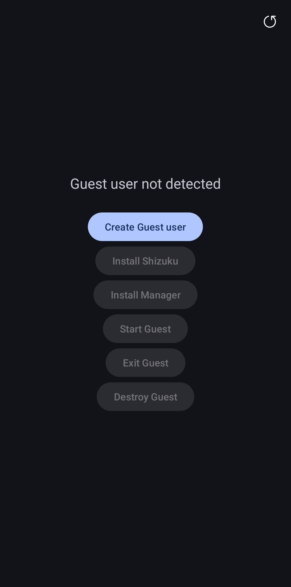
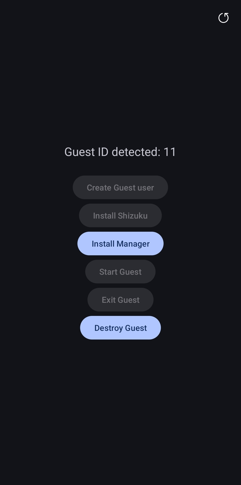
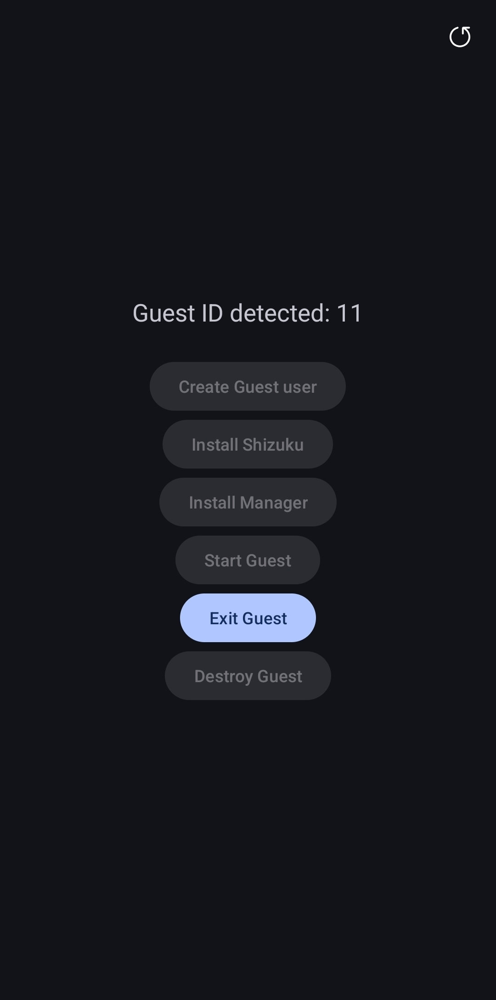

|                Main Screen 1                |                Main Screen 2                |                Guest Screen                 |
|:-------------------------------------------:|:-------------------------------------------:|:-------------------------------------------:|
|  |  |  |

# Guest-Manager
Bypass manufacturer restrictions to enable Guest and multi-user modes on unsupported Android devices.
Powered by Shizuku for seamless system-level user management without root.

제조사가 멀티유저 기능을 차단한 안드로이드 기기에서 게스트 모드를 활성화합니다.
Shizuku를 통해 루팅 없이 시스템 유저 환경을 제어합니다.

### Known Issue
- Does not work on One UI 8.5 and above.