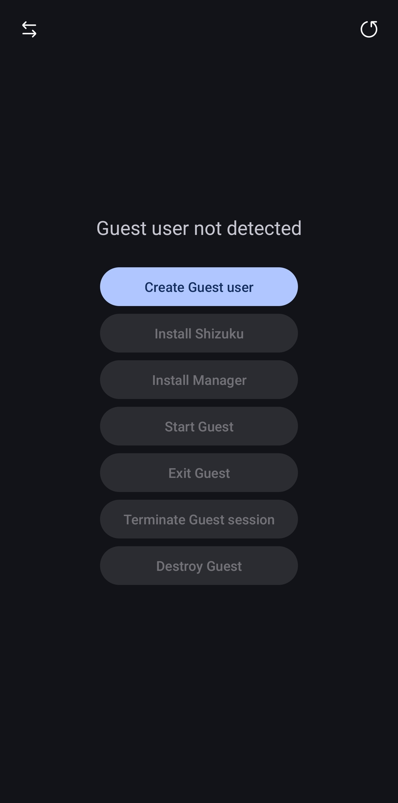
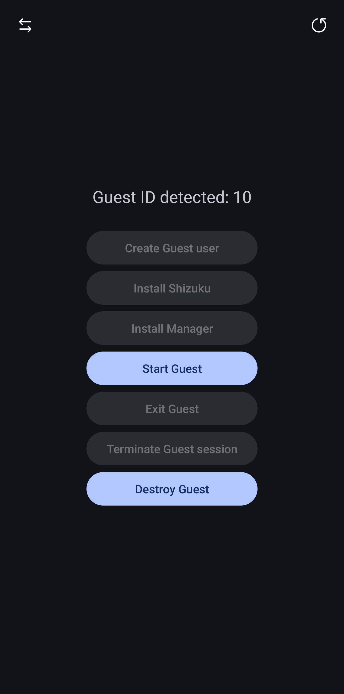
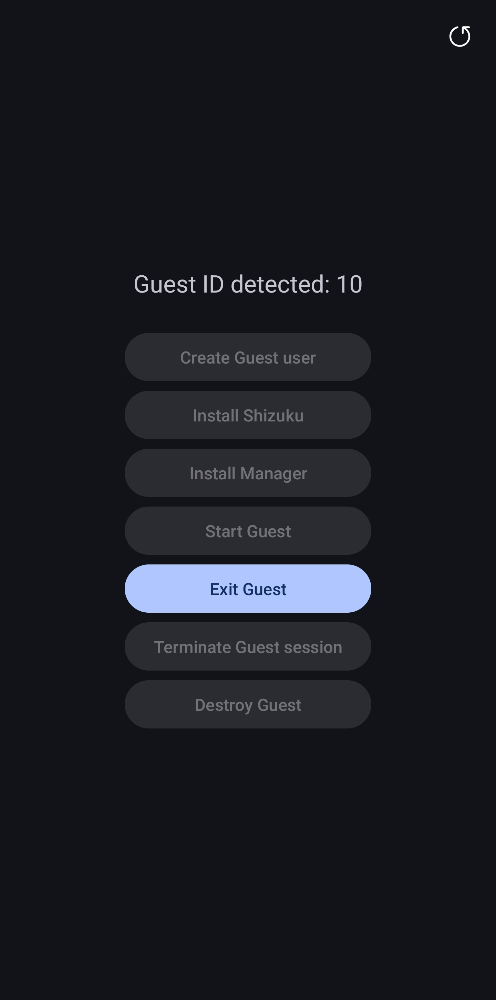
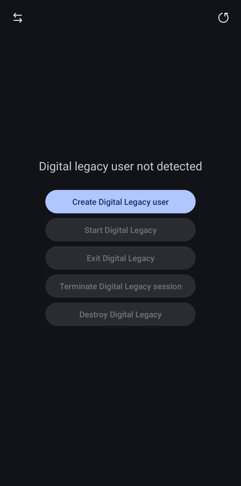
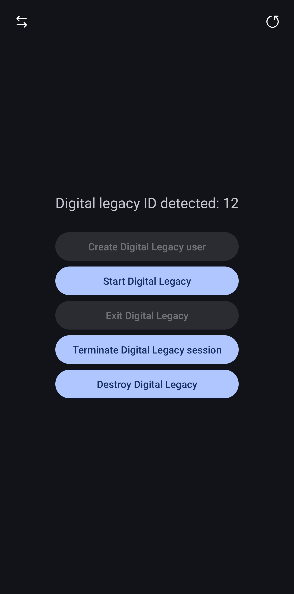
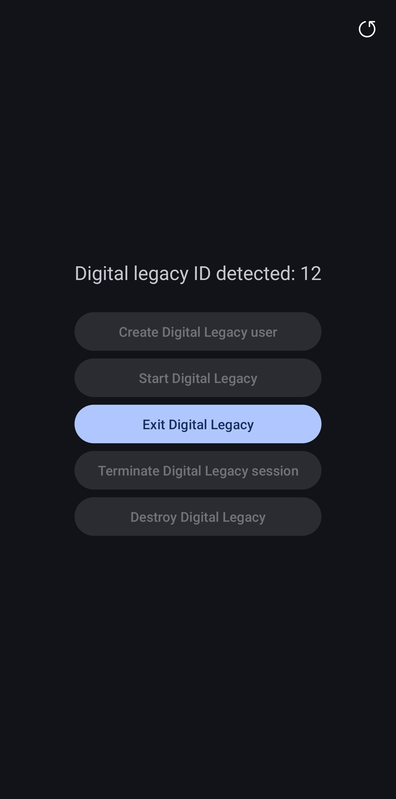

# User-Hopper
> Enable guest and secondary-user management on Android devices where the manufacturer has restricted multi-user functionality, without root access.

[English](./README.md) · [한국어](./README.ko.md)

---
> User-Hopper uses [Shizuku](https://shizuku.rikka.app/) to manage Android users without root access.

## Modes
|                   | Guest mode                                                                              | Digital Legacy mode                                                                     |
| ----------------- |-----------------------------------------------------------------------------------------| --------------------------------------------------------------------------------------- |
| Supported devices | Android devices generally, including Samsung Galaxy devices running One UI 8.0 or lower | Samsung Galaxy phones running One UI 7.0 or higher                                      |
| User creation     | Created directly by the app (`pm create-user --guest`)                                  | Created through Samsung's Digital Legacy feature to work around multi-user restrictions |
| App installation  | Install Shizuku and User-Hopper into the guest user                                     | Automatically installs Shizuku and User-Hopper into the detected user                   |
| Notes             | Digital Legacy mode can also be used on One UI 7.0–8.0                                  | On One UI 8.5 or later, the Digital Legacy interface may open automatically             |

## Features
* Create, start, exit, and delete a secondary user.
* End a secondary user's session without deleting the user, stopping all apps running in that user.
* Enable or disable actions according to the current user, user existence, and session state.
* Automatically detect a Digital Legacy user and install Shizuku and User-Hopper into it.
* Save failed shell commands to `Documents/UserHopper/command_log.txt`.

## Requirements
* [Shizuku](https://shizuku.rikka.app/) installed and running, with permission granted to User-Hopper.
* For Digital Legacy mode, a supported Samsung Galaxy phone with the Digital Legacy feature.

## Usage
### Guest mode
|                  Main Screen 1                  |                  Main Screen 2                  |                  Guest Screen                   |
|:-----------------------------------------------:|:-----------------------------------------------:|:-----------------------------------------------:|
|  |  |  |

1. Start Shizuku and open User-Hopper. Grant the requested Shizuku permission.
2. Tap **Create Guest User** to create a guest user.
3. Tap **Install Shizuku** and **Install Manager** to install both apps into the guest user.
4. Tap **Start Guest** to switch to the guest user.
5. To return to the owner user, open User-Hopper inside the guest user and tap **Exit Guest**.

### Digital Legacy mode
|                  Main Screen 1                  |                  Main Screen 2                  |              Digital Legacy Screen              |
|:-----------------------------------------------:|:-----------------------------------------------:|:-----------------------------------------------:|
|  |  |  |

1. Start Shizuku and open User-Hopper. Grant the requested Shizuku permission.
2. Tap **Create Digital Legacy User** to open the Digital Legacy app's information page.
3. Open the Digital Legacy settings and tap the Digital Legacy request button to create the user and switch to it.
4. User-Hopper detects the new user, disables the Digital Legacy feature within that user, and installs Shizuku and User-Hopper automatically.
5. To return to the owner user, open User-Hopper inside the secondary user and tap **Exit**.

## Important notes
### General
- **You may get stuck in the secondary user.** On devices that do not officially support switching between secondary users, you may be unable to return to the owner user if Shizuku stops running or User-Hopper is uninstalled. Make sure Shizuku is running and User-Hopper has permission in the secondary user before switching. If Shizuku stops, you may need to use USB debugging to switch users or restart the device. Restarting may cause unsaved data in the owner user to be lost.
- Use this project at your own risk. This project is not affiliated with Samsung or Google.

### Guest mode
- **Do not reset the guest session when prompted by the system after switching to the guest user.** Resetting the session may remove Shizuku and User-Hopper from the guest user. On devices without a user-switching toggle, this may leave you unable to return to the owner user.

### Digital Legacy mode

- **Use this mode only if you understand the implications of using Samsung's Digital Legacy feature for this purpose.** The feature is intended to securely transfer a deceased person's phone data, such as contacts and notes stored in Samsung Cloud, to a designated Legacy Contact. If you actually need the Digital Legacy feature, delete the secondary user created for this purpose and submit the request directly through Settings.
- If you submit a Digital Legacy request directly through Settings instead of User-Hopper, the normal Digital Legacy interface is displayed. When you start the user through User-Hopper, the Digital Legacy feature is disabled within that user so it can be used like a regular secondary user.
- Digital Legacy mode is not supported on Samsung Galaxy tablets or devices from other manufacturers.

## How it works
User-Hopper executes standard Android shell commands through Shizuku.

| Action                              | Shell command                                           |
| ----------------------------------- |---------------------------------------------------------|
| Create guest user                   | `pm create-user --guest Guest`                          |
| Install an existing app into a user | `pm install-existing --user <id> <package>`             |
| Start / exit a user                 | `am switch-user <id>`                                   |
| End a user's session                | `am stop-user -w -f <id>`                               |
| Delete a user                       | `pm remove-user <id>`                                   |
| Disable / enable Digital Legacy     | `pm disable-user --user <id>` / `pm enable --user <id>` |
| Detect users and sessions           | `pm list users`                                         |

## Troubleshooting
- **A button is disabled:** The action may not be available in the current state. For example, the Start button is disabled when you are already inside the secondary user. Tap the Refresh button in the upper-right corner.
- **Shizuku errors:** Make sure Shizuku is running and permission has been granted. Failed commands are logged at `<device storage>/Documents/UserHopper/command_log.txt`.
- **Exit is disabled inside the secondary user:** Shizuku may not be running in that user, or User-Hopper may not have Shizuku permission.

## License
This project is licensed under the GNU General Public License v3.0 or, at your option, any later version (GPL-3.0-or-later).

See the [LICENSE](./LICENSE) file for the full license text.

## Credits
* [RikkaApps - Shizuku](https://shizuku.rikka.app/)
* [Android - Multi-user support](https://source.android.com/docs/devices/admin/multi-user)
* [Samsung - Digital Legacy](https://digital-legacy.samsung.com/)
